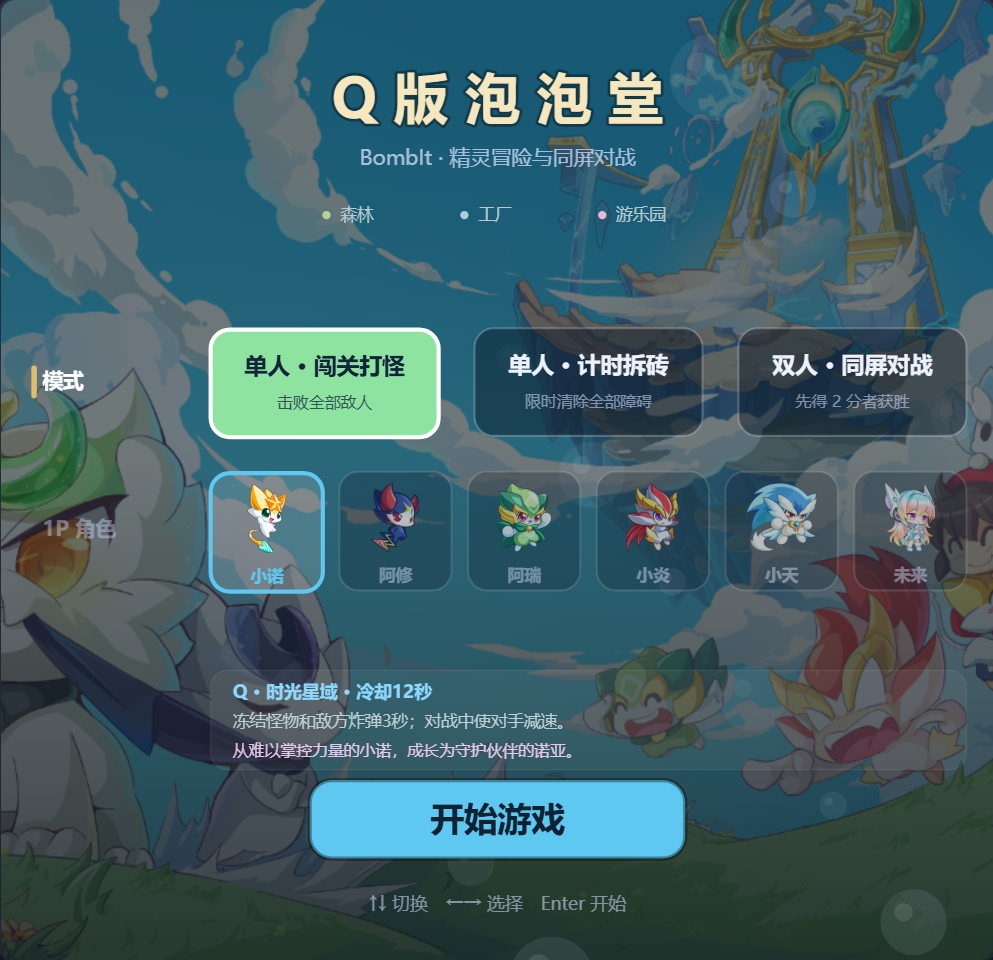
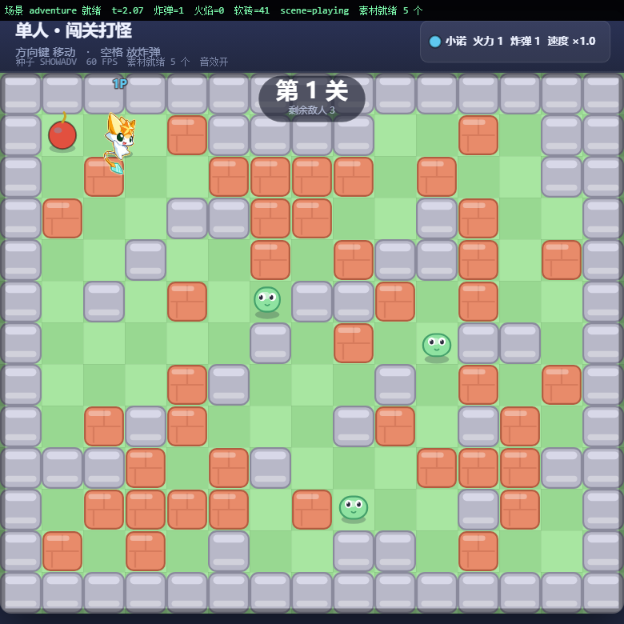

# Q版泡泡堂 · BombIt

一个用 **HTML5 Canvas + 原生 JavaScript** 写的 Q 版炸弹人对战小游戏：单人闯关打怪、单人计时拆砖、双人同屏对战，共六位精灵角色、十关冒险、三张主题地图。

**零安装、零依赖、零构建、零联网** —— 整个文件夹拷到任何电脑，双击就能玩。

作者：**初霁**



---

## 怎么玩

| 方式 | 操作 |
|---|---|
| **推荐** | 双击 `启动游戏.bat` —— 加载完就有背景音乐，`F5` 刷新也一样 |
| 直接玩 | 双击 `index.html`（Chrome / Edge）。浏览器默认不许页面在交互前出声，点一下画面或按个键就有音乐 |

**操作键位**

| 模式 | 玩家 | 移动 | 放炸弹 | 技能 |
|---|---|---|---|---|
| 单人（闯关打怪 / 计时拆砖） | 1P | `↑↓←→` 或 `WASD` | `空格` | `Q` |
| 双人（同屏对战） | 1P | `↑↓←→` | `Enter` | 右 `Shift` |
| 双人（同屏对战） | 2P | `WASD` | `空格` | `F` |

其他：`Esc`/`P` 暂停　`R` 重开本局　`Tab` 切换 1P 备用键位（`IJKL`/`U`/`O`）　`M` 静音（音效 + 音乐）

## 玩法

- **单人 · 闯关打怪**：共 10 关，清光每关的敌人过关，第 5、10 关是鲁鲁旦 BOSS 战（三阶段：试探 / 认真 / 暴走）。
- **单人 · 计时拆砖**：限时炸掉全部障碍。
- **双人 · 同屏对战**：先得 2 分者获胜。
- 道具：火力 +1、炸弹数 +1、速度 +10%、生命果实、无敌星、护盾、推弹手套、踢弹。
- 六位精灵各有一个技能：小诺冻结、阿修突进、阿瑞护盾缠斗、小炎吸爆反弹、小天洞察加速，未来的「迁境奇点」是放弹被动（放弹 6 次或击杀 1 只即通灵，减速更强、范围更大）。



## 背景音乐

| 场景 | 曲目 |
|---|---|
| 菜单 | 天空之城（八音盒版） |
| 关卡对局 | カノン（八音盒版） |
| BOSS 战（鲁鲁旦存活期间） | 欢乐斗地主背景音乐 |

曲目由场景推导，换曲交叉淡入淡出；暂停 / 失焦时停住，`M` 键静音和音效一起生效。

## 目录结构

```
├── index.html                入口，双击即玩
├── 启动游戏.bat              带自动播放放行的启动器（推荐入口）
├── 运行测试.bat              一键跑全部测试（需要 Node + Edge/Chrome）
├── assets/
│   ├── characters.js         角色素材配置
│   ├── characters/           高清角色 PNG（含背面、通灵形态）
│   ├── enemies/              小怪与 BOSS 素材
│   ├── audio/                三首背景音乐（Ogg Vorbis）
│   └── ui/                   开始界面壁纸
├── src/
│   ├── core/                 配置、随机数、输入
│   ├── game/                 地图生成、移动、规则、威胁图、敌人 AI、赛制
│   ├── render/               绘制工具、素材加载、场景与角色、HUD、特效
│   ├── audio/                合成音效 + 背景音乐
│   ├── scenes/               菜单、暂停、结算
│   └── main.js               启动 + 固定步长主循环 + 场景状态机
├── tests/
│   ├── headless.js           无头逻辑测试（Node，无需浏览器）
│   └── browser.html          浏览器测试（真实键盘事件 / 渲染 / 音频）
├── tools/                    素材提取与文档截图工具
├── docs/                     设计与使用文档、截图
└── aqcs/                     原始素材投放处（图鉴原图、壁纸原图；第三方素材，未纳入版本库）
```

## 跑测试

```
运行测试.bat          :: 逻辑测试 + 浏览器测试（需装 Node 和 Edge/Chrome）
node tests\headless.js  :: 只跑逻辑测试
```

无头逻辑测试覆盖地图生成与连通性、爆炸与连锁、敌人 AI、威胁图、移动手感、赛制判定、技能与通灵、音乐场景映射等；浏览器测试覆盖键位表、真实键盘与鼠标事件、场景状态机、音频解锁与播放、渲染与缩放、运行期零报错。

## 文档

- [使用说明](docs/使用说明.md) —— 键位、模式、道具、技能、常见问题
- [设计方案](docs/设计方案.md) —— 技术选型、架构、数值与美术流水线
- [技能与场景](docs/技能与场景.md) · [敌人与BOSS](docs/敌人与BOSS.md) · [角色背景与文案](docs/角色背景与文案.md)

## 说明

游戏代码为原生 JavaScript，无任何第三方库。角色与敌人美术取材自《奥奇传说》并做了抠图与重制，仅供个人学习与娱乐使用，请勿用于商业用途。
