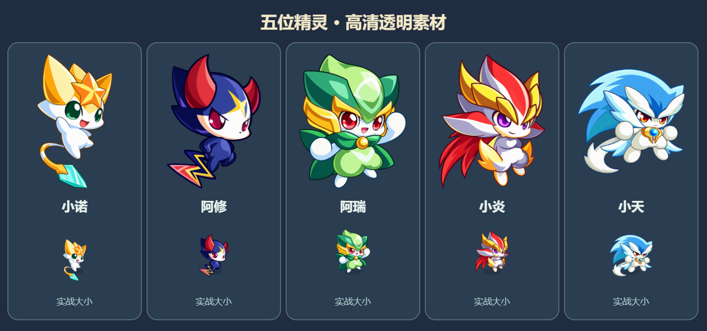

# 角色素材

六位可选精灵（小诺、阿修、阿瑞、小炎、小天、未来）以及未来的通灵形态，各有**正面**与**背面**两张运行期素材。素材全部用内置 **image_gen** 按用户提供的图鉴参考重制，再用 `tools/extract_characters.py` 抠图、裁切对齐；没有下载官方高清原图，也没有使用 CLI。

运行期文件放 `assets/characters/`，裁切、显示高度与脚底锚点配置在 [`assets/characters.js`](../assets/characters.js)。**原始高清文件继续保留**，`aqcs/` 里的第三方原图不进版本库。

## 正面（清晰版）

以图鉴卡片和角色近照为参考，恢复线条与细节，去掉黄色图鉴背景、法阵与文字。原有小图保留，新版以独立文件接入，配色、主要特征与姿势沿用参考。

| 角色 | 清晰版 | 原图尺寸 |
|---|---|---|
| 小诺 | [xiaonuo-hd.png](../assets/characters/xiaonuo-hd.png) | 1145×1374 |
| 阿修 | [axiu-hd.png](../assets/characters/axiu-hd.png) | 1180×1333 |
| 阿瑞 | [arui-hd.png](../assets/characters/arui-hd.png) | 1230×1278 |
| 小炎 | [xiaoyan-hd.png](../assets/characters/xiaoyan-hd.png) | 1210×1300 |
| 小天 | [xiaotian-hd.png](../assets/characters/xiaotian-hd.png) | 1399×1124 |

未来的两个形态同样是高清透明 PNG：普通形态 `weilai-hd.png`、通灵形态 `weilai-awakened-hd.png`，通灵素材不作为第七名角色出现在选角列表。

透明留白通过裁切坐标去除，并重新校正脚底锚点。加载时一次性创建 512 像素高的显示缓存，选人界面与实战共用；游戏绘制无需每帧把千像素原图重新缩小。画布启用高质量图像缩放并保持原有高像素密度适配。素材缺失时回退几何占位小人或渐变背景，不影响开局。

提示词与裁切记录：[hd-prompts.json](../assets/characters/hd-prompts.json)、[hd-metadata.json](../assets/characters/hd-metadata.json)、[weilai-prompt.txt](../assets/characters/weilai-prompt.txt)、[weilai-awakened-prompt.txt](../assets/characters/weilai-awakened-prompt.txt)。

## 背面

向上移动时显示背面，向下切回正面，左右沿用原朝向；松开按键保持最后朝向。对角输入以实际选中的移动轴决定朝向，碰墙时也可转身，传送带和木马不会强制改变朝向。重生和换关从正面开始。

单双人键位均生效，双方朝向互不影响。选角列表仍为六人，方向变体不会重复出现在菜单。未来通灵前后的背面会随形态切换，保留光晕与守护灵效果。

背面使用与正面相同的角色坐标和碰撞框，只改变显示；各素材单独校准裁切、显示高度与脚底锚点。背面不做左右镜像，尚未加载时自动回退对应正面。背面同样在加载时缓存为 512 像素纹理，不在每帧重新缩小原图。

| 角色 | 正面参考 | 最终背面 |
|---|---|---|
| 小诺 | [正面](../assets/characters/xiaonuo-hd.png) | [xiaonuo-back-hd.png](../assets/characters/xiaonuo-back-hd.png) |
| 阿修 | [正面](../assets/characters/axiu-hd.png) | [axiu-back-hd.png](../assets/characters/axiu-back-hd.png) |
| 阿瑞 | [正面](../assets/characters/arui-hd.png) | [arui-back-hd.png](../assets/characters/arui-back-hd.png) |
| 小炎 | [正面](../assets/characters/xiaoyan-hd.png) | [xiaoyan-back-hd.png](../assets/characters/xiaoyan-back-hd.png) |
| 小天 | [正面](../assets/characters/xiaotian-hd.png) | [xiaotian-back-hd.png](../assets/characters/xiaotian-back-hd.png) |
| 未来 | [正面](../assets/characters/weilai-hd.png) | [weilai-back-hd.png](../assets/characters/weilai-back-hd.png) |
| 通灵未来 | [正面](../assets/characters/weilai-awakened-hd.png) | [weilai-awakened-back-hd.png](../assets/characters/weilai-awakened-back-hd.png) |

背面用 image_gen 依据现有正面生成：小天移除了属于正面的项链装饰；通灵守护灵补全后脑甲、背甲、机械脊线和手背。未来普通背面采用通灵图中本体的造型，靴子改为后跟视角。

通灵背面反转前后遮挡关系，最终层次为：**翅膀最前 → 守护灵躯干 → 未来本体最后**。翼根和内侧羽片覆盖部分背甲与上臂；守护灵躯干为平整机械背甲、散热口、翼根铰链、后腰连接件，不含正面胸甲和腹甲式的宝石板块。

完整生成及修整提示词：[back-prompts.json](../assets/characters/back-prompts.json)、[未来两形态修正](../assets/characters/weilai-back-corrections.json)、[守护灵最终修正](../assets/characters/guardian-back-corrections.json)。

敌人的素材与显示尺寸见 [敌人与BOSS](敌人与BOSS.md)。
